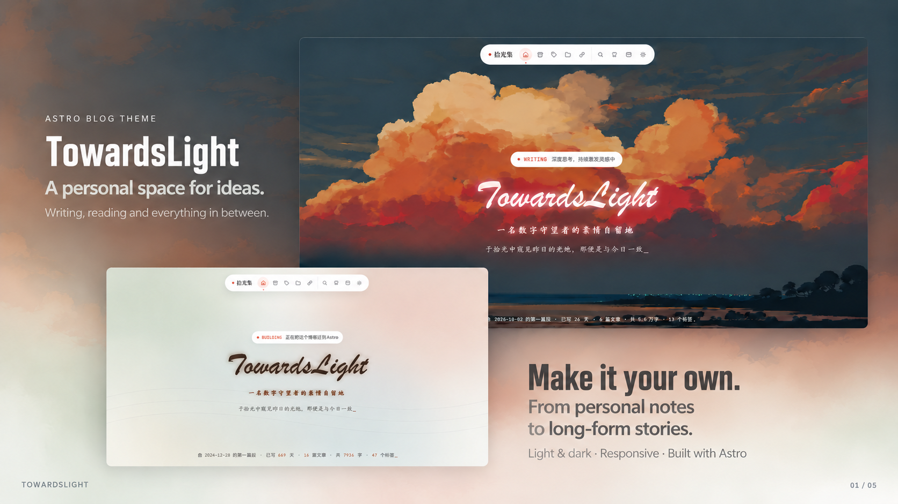
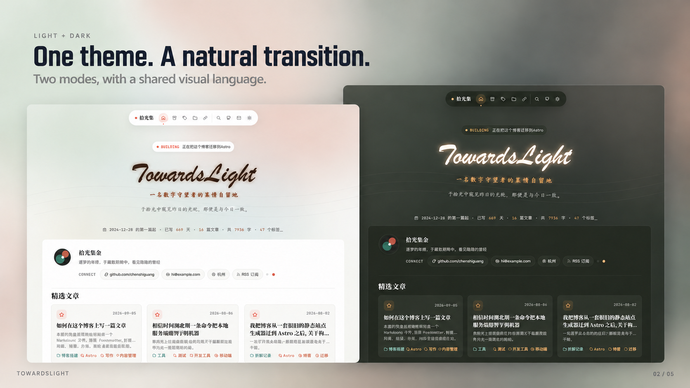
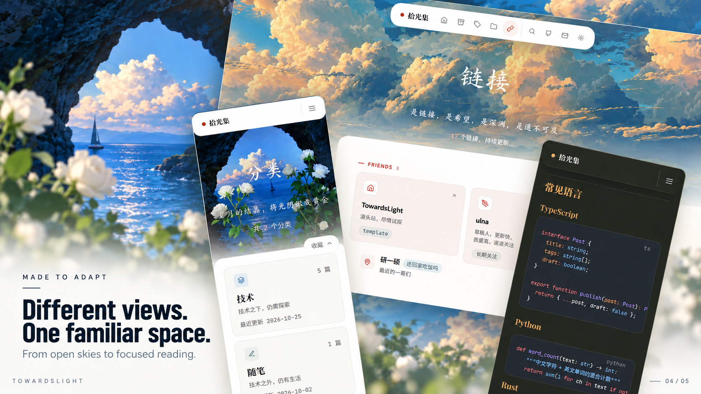

<h1 align="center">拾光集 · TowardsLight</h1>

<p align="center">
  
  
  
</p>

<p align="center"><strong>一套把内容边界、Markdown 编译链与视觉状态纳入同一静态构建流程的 Astro 写作系统。</strong></p>

<p align="center"><a href="./README.md">简体中文</a> · <a href="./README.en.md">English</a></p>



## 为什么选择拾光集

TowardsLight 将个人内容、渲染规则和页面表达放在三个明确的层次里：档案决定“哪些内容可以被构建”，Markdown 管线决定“内容如何成为结构”，界面层决定“结构与状态如何被阅读”。因此，它既是一套个人站点模板，也是一套可以独立演进的静态发布系统。

| 方向                    | 能力                                                                                                                   |
| ----------------------- | ---------------------------------------------------------------------------------------------------------------------- |
| **内容与模板**    | 独立内容档案 · 外部目录 / `personal/` / 内置示例自动识别 · 空目录生成站点配置、首篇文章与 CI · 模板和内容独立维护 |
| **Markdown 渲染** | KaTeX 公式 · 手绘风 Mermaid（明暗双版、图与源码切换） · 提示块 · 图片图注 · 双主题代码高亮与复制                   |
| **长文阅读**      | 按阅读位置渐进展开的目录 · 当前章节笔触标记 · 移动端完整目录 · 阅读进度 · 图片灯箱与键盘操作                       |
| **主题与动效**    | 首屏无闪烁的明暗主题 · 软导航状态延续 · Hero 壁纸羽化过渡 · Dock 导航联动动效 · 减少动态效果适配                   |
| **图片工程**      | 文章图片资产管线优化 · 站点大图 WebP 派生 · 缺失图占位与告警 · 档案切换缓存隔离                                     |
| **搜索与发布**    | Fuse.js 全文搜索 · 快捷唤起与命中重排 · 全站预取 · 慢导航反馈 · RSS、Sitemap、分享卡片与结构化数据                 |

## 界面

以下四张场景图分别展示主题系统、长文阅读、响应式重排与内容发现。

| 主题系统 / Light + Dark                                                                                        | 长文阅读 / Room to Read                                                                                         |
| :------------------------------------------------------------------------------------------------------------- | :-------------------------------------------------------------------------------------------------------------- |
| 语义令牌 · 明暗双主题 · 统一构图      | 文章排印 · 手绘图解 · 编辑器工作流 |
| **响应式重排 / Made to Adapt**                                                                           | **内容发现 / Explore Your Space**                                                                         |
| 桌面 · 移动端 · 链接目录 · 代码阅读 | 年份归档 · 标签聚合 · 空间化内容探索    |

## 快速开始

推荐 Node.js 22。Astro 5 同时支持 Node.js `18.20.8`、`20.3+` 与 `22+`。在项目根目录运行：

```bash
git clone https://github.com/iceforYuri/TowardsLight.git
cd TowardsLight
npm install
npm run dev       # http://localhost:4321
```

生产构建会先做类型检查，再将静态站点输出到 `dist/`：

```bash
npm run build
npm run preview
```

没有显式指定档案，且根目录不存在有效的 `personal/site.ts` 时，项目会使用内置 `showcase` 示例档案。

## 档案机制

文章、站点配置、链接和图片共同组成一个**档案目录**。模板通过 `src/profiles/active` 读取当前档案，并通过 `public/images` 将站点级图片映射到同一来源。解析顺序为：

1. `SITE_PROFILE_DIR` 环境变量显式指定的目录；
2. 项目根目录的 `personal/`，前提是其中存在 `site.ts`；
3. `src/profiles/showcase/` 内置示例。

`site.ts`、`links.ts` 和 `posts/` 是必需项，`images/` 可选。切换档案时，脚本会重建指向、校验目标目录，并在指向发生变化时清理 Astro 内容缓存。一个工作副本同一时间服务一个档案；需要并排比较两套内容时，应为第二套档案建立独立的 `git worktree`。

### 从空目录创建档案

```powershell
npm run new-profile -- C:/path/to/my-blog-data
$env:SITE_PROFILE_DIR = 'C:/path/to/my-blog-data'
npm run dev
```

`new-profile` 会在目标为空时生成一套可启动的档案骨架，包括 `site.ts`、`links.ts`、`posts/`、`images/`、第一篇草稿以及基于模板仓库的构建校验工作流。若目标为空目录之外没有额外设置，放在项目根目录的 `personal/` 会被自动命中，并可用独立 Git 仓库维护。

```text
my-blog-data/
├── site.ts      # 站名、作者、Hero、默认主题、页面文案与分类配置
├── links.ts     # 链接分组、色调、卡片形态、状态与首页展示规则
├── posts/       # Markdown 文章
│   └── image/   # 文章级图片，以相对路径引用
└── images/      # 可选：头像、Hero、页面背景与共用封面，以 /images/... 引用
```

档案目录切换后请重启正在运行的 dev server。内容仓库与模板仓库分离时，升级模板无需合并私人文章；由档案新增的配置字段仍应在模板升级后及时补齐。

## Markdown 渲染管线

| 内容类型               | 当前实现                                                                                                                                           |
| ---------------------- | -------------------------------------------------------------------------------------------------------------------------------------------------- |
| **数学公式**     | `remark-math` 解析；`KaTeX 0.16.47` 构建期 HTML；零公式运行时；版本锁定上下标与重叠规则                                                        |
| **Mermaid 图表** | Playwright Chromium 构建期渲染；串行明暗双版 SVG；`handDrawn` 手绘风格；固定 `handDrawnSeed`；图与源码切换；语法错误、浏览器不可用时回退代码块 |
| **提示块**       | `NOTE` / `TIP` / `IMPORTANT` / `WARNING` / `CAUTION` 五类语义；自定义标题；`+` / `-` 控制原生 `<details>` 初始状态                 |
| **正文图片**     | Astro 资产管线；`alt` 自动图注；remark + Vite 双层哨兵；缺失图 SVG 占位；原路径告警                                                              |
| **代码块**       | Shiki 明暗双主题 token；原始 fence 语言徽章；复制按钮；软导航幂等绑定                                                                              |
| **图片交互**     | 零第三方依赖；点击 / Enter / Space / ESC / 背板关闭；滚动锁；焦点归还；失败图保护；`prefers-reduced-motion`                                      |

## 写一篇文章

在当前档案的 `posts/` 下新建 `.md` 文件：

```yaml
---
title: 文章标题
description: 文章摘要
pubDate: 2026-09-05
updatedDate: 2026-09-06         # 可选
category: 前端
tags: [Astro, 博客]
draft: false                    # true 时不进入公开构建和索引
cover: /images/covers/wide.svg  # 可选；也可使用 image/my-post/cover.jpg
coverAlt: 封面描述               # 可选
coverPosition: center 30%        # 可选，调整裁切焦点
featured: false                 # 可选，首页精选文章
---
```

文章图片建议放在 `posts/image/<文章名>/` 下，并以相对路径引用。提示块在引用块首行写入类型标记：

```md
> [!NOTE]+ 自定义标题
> 这段内容默认展开。
```

首页最多展示三篇 `featured` 文章；近期文章只排除实际展出的精选，因此超出上限的精选仍会按时间自然回落。完整写法见内置示例文章《如何在这个博客上写一篇文章》。

## 主题、导航与反馈

明暗主题由档案中的 `themeDefault` 与访客的本地选择共同决定，颜色、表面、边框和强调色统一通过语义变量管理。首次绘制前的内联脚本会在 `localStorage`、档案默认值和系统配色之间完成选择；View Transition 软导航时，当前主题、导航方向和页面类型会复制到新文档，避免刷新成另一套视觉状态。

首页的壁纸冻结由 sticky 轨道驱动，脚本只计算身份组与主卡片之间需要补充的行程，不通过逐帧滚动事件模拟 fixed。页面预取采用 `load` 策略，所有静态页面在加载完成后进入缓存；只有导航超过 120ms 时才显示进度，避免快速切换时闪烁。Dock、壁纸、羽化幕布和搜索层分别处于明确的 z-index 与转场层中，动效关闭后仍保留完整的布局与操作路径。

## 配置站点

| 配置面               | 位置与职责                                                                                 |
| -------------------- | ------------------------------------------------------------------------------------------ |
| **内容身份**   | 档案 `site.ts`；站名、作者、Hero、页面文案、默认主题、当前状态与分类呈现                 |
| **链接空间**   | 档案 `links.ts`；分组与色调、链接状态、链接页卡片、首页“常用去处”（最多三项）          |
| **视觉令牌**   | `src/styles/global.css`；明暗主题画布、表面、文字、边框、强调色、阴影与排版尺度          |
| **构建与部署** | 档案 `site.ts` 的 `siteUrl`；`SITE_URL` / `SITE_BASE` 环境变量覆盖；子路径感知链接 |

`featured` 在链接页控制大卡片形态，`home` 控制首页展示；二者相互独立。修改当前档案后重新启动 dev server，指向变化及内容缓存清理会在下一次启动日志中明确显示。

## 项目结构

```text
src/
├── components/       页面组件、目录、灯箱、搜索与主题控件
├── layouts/          页面壳层、主题初始化与软导航状态
├── pages/            首页、文章、归档、标签、分类、链接与内容索引
├── plugins/          Markdown、图片、图注与提示块处理器
├── profiles/         当前档案指向与内置 showcase
├── scripts/          图、代码复制与导航等渐进增强
├── styles/           语义令牌、排版与 View Transition 样式
└── utils/            内容排序、URL、图片派生与阅读统计
```

模板代码与档案内容遵循同一 Schema，但不共享版本历史。页面路由只负责组织编译结果，内容图片、链接索引、搜索结果与 RSS 均由当前档案派生。

## 命令

| 命令 | 作用 |
| --------------------------------- | ---------------------------------------------- |
| `npm run dev` | 解析当前档案 · 生成图片派生 · 启动开发服务器 |
| `npm run build` | `astro check` · 生产构建 · 输出 `dist/` |
| `npm run preview` | 本地预览生产构建 |
| `npm test` | 图片哨兵测试 · 提示块测试 |
| `npm run check` | Astro 检查 · TypeScript 检查 |
| `npm run frontmatter:check` | 检查当前档案文章元数据 |
| `npm run new-profile -- <目录>` | 空目录档案脚手架 · 首篇文章 · 构建校验工作流 |
| `npm run fonts` | 更新自托管字体资源 |
| `npm run fonts:display` | 重新生成标题艺术体子集 |

## 部署

执行 `npm run build`，将 `dist/` 发布到任意静态托管平台。正式域名写入档案的 `siteUrl`，或通过 `SITE_URL` 覆盖；部署在子路径时设置 `SITE_BASE`。canonical、RSS、sitemap、页面内部链接与结构化数据会使用同一组 URL 信息。

## 相关项目

- [TowardsLight_extension](https://github.com/iceforYuri/TowardsLight_extension)：配套 VS Code 扩展，在侧边栏管理文章、分类、链接与站点配置，并从编辑器启动真实开发服务器预览。

## 图标与字体

图标来自按需输出的内联 Lucide SVG。正文与界面字体自托管于 `public/fonts/`，包括 Playfair Display、Noto Serif SC、Noto Sans SC、Inter 与 JetBrains Mono；首页与章节标题另使用子集化艺术字体。字体使用本地别名族名和系统回退，避免同名可变字体改变既定字重。

## License

MIT
